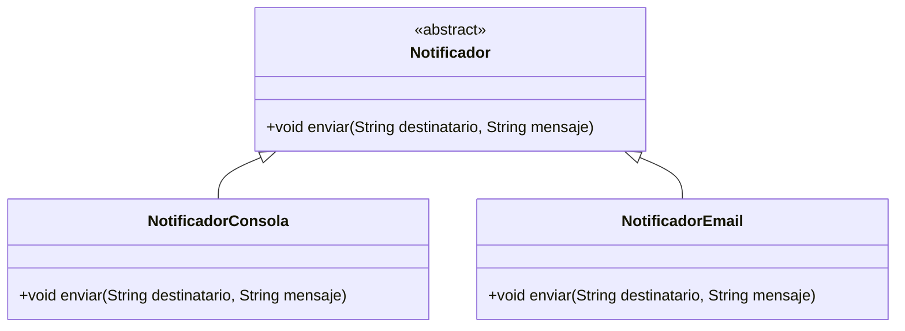

# Prácticas TDS: Selección e implementación de patrones de diseño

**Lenguaje de programación:** Java 17 o superior  
**Entorno de desarrollo:** Maven  
**Tipo de aplicación:** Aplicación de consola

## 1. Objetivos

El objetivo de esta práctica es trabajar con patrones de diseño mediante la evolución progresiva de una aplicación Java sencilla.

A partir de un proyecto inicial, se plantearán nuevos requisitos que obligarán a modificar o ampliar el diseño de la aplicación. Para cada requisito, será necesario analizar el problema, identificar una solución de diseño adecuada e implementar los cambios necesarios utilizando patrones de diseño.

Concretamente, se pretende que el alumno sea capaz de:

- Identificar problemas habituales de diseño en aplicaciones software.
- Seleccionar el patrón de diseño más adecuado para resolver un problema concreto.
- Comprender la estructura y las responsabilidades de los participantes de cada patrón.
- Implementar patrones de diseño utilizando Java.

## 2. Proyecto inicial: Gestor de tareas

Se proporciona una aplicación Java denominada **Gestor de tareas**, cuya finalidad es permitir la gestión básica de tareas personales.

La aplicación permitirá crear tareas, consultar las existentes, marcarlas como completadas y eliminarlas.

Se trata de una aplicación sencilla, implementada como programa de consola, que mantiene toda la información en memoria durante la ejecución.

### 2.1. Requisitos funcionales

El proyecto inicial proporciona las siguientes funcionalidades:

1. **Crear tareas.** Se podrá crear una tarea indicando:
   - Identificador (generado automáticamente).
   - Título.
   - Descripción.
   - Prioridad (BAJA, MEDIA o ALTA).

2. **Consultar tareas.** Se podrá obtener el listado de todas las tareas registradas.

3. **Buscar tareas.** Se podrá localizar una tarea a partir de su identificador.

4. **Completar tareas.** Se podrá marcar una tarea como completada.

5. **Eliminar tareas.** Se podrá eliminar una tarea a partir de su identificador.

6. **Consultar estadísticas.** Se podrá obtener el número de tareas que todavía están pendientes de completar.

### 2.2. Organización del proyecto

El proyecto inicial presenta una estructura sencilla, organizada en los siguientes paquetes:

```text
src/main/java/
└── es/umu/gestor/
    │
    ├── Main.java
    │
    ├── model/
    │   ├── Tarea.java
    │   └── Prioridad.java
    │
    └── service/
        └── GestorTareas.java
```

Las principales clases son:

- **Tarea:** representa una tarea individual. Contiene sus atributos y las operaciones necesarias para consultar su información y modificar su estado.
- **Prioridad:** enumerado que define los posibles niveles de prioridad de una tarea.
- **GestorTareas:** proporciona las operaciones de gestión de tareas. Mantiene una colección de objetos `Tarea` y permite realizar las operaciones descritas anteriormente.
- **Main:** contiene el punto de entrada de la aplicación y permite comprobar el funcionamiento de las operaciones implementadas.

El proyecto utiliza Java 17 y Maven, sin necesidad de incorporar bibliotecas externas.

## 3. Ejercicios de ampliación de requisitos

A continuación, se proponen cinco ejercicios que amplían los requisitos funcionales de la aplicación inicial.

Cada ejercicio debe resolverse partiendo de una copia independiente del proyecto base. No es necesario implementar los ejercicios de forma acumulativa.

En cada caso, el alumno deberá analizar el nuevo requisito, identificar el problema de diseño que plantea y proponer una solución basada en un patrón de diseño.

### Ejercicio. Incorporación de diferentes mecanismos de notificación

Se desea ampliar la aplicación para que notifique al usuario cuando se produzcan determinados acontecimientos durante la gestión de las tareas. Inicialmente, se mostrarán mensajes (notificaciones) cuando:

- Se cree una nueva tarea.
- Se complete una tarea.

Sin embargo, se plantea la posibilidad de incorporar diferentes mecanismos de notificación (notificadores). Por ejemplo:

- Notificador por consola.
- Notificador por correo electrónico.
- Otros notificadores como: mensajes SMS, etc...

No es necesario implementar el envío real de correos electrónicos ni de SMS. Será suficiente con simular su funcionamiento mostrando los mensajes de notificación correspondientes por consola (`sysout`). A continuación se muestran la abstracción de notificadores:



El sistema deberá permitir seleccionar el notificador que se utilizará durante la ejecución de la aplicación. Además, la lógica de gestión de tareas (`GestorTareas`) no deberá depender de las implementaciones concretas de los notificadores. Es decir, la clase `GestorTareas` no debería tener que modificarse cuando se incorpore un nuevo notificador.

**Se pide:**

Analizar el problema e identificar el patrón de diseño que permitiría encapsular la creación de los diferentes mecanismos de notificación. Implementar el mecanismo necesario para crear y seleccionar el notificador que se utilizará.

Después, modificar la clase `GestorTareas` para que pueda utilizar cualquier implementación de la abstracción definida (`Notificador`) y modificar la clase `Main` para que permita seleccionar un notificador.

**Consideraciones:**

- El gestor de tareas no debe crear directamente los objetos notificadores.
- La selección del notificador debe estar desacoplada de la lógica de negocio (`GestorTareas`).

### Ejercicio. Incorporación de una configuración global (uso de Singleton)

Se desea incorporar un mecanismo de configuración general de la aplicación.

Entre las opciones de configuración se encuentran:

- Nombre de la aplicación.
- Indicación de si deben mostrarse las tareas completadas.
- Otras opciones generales que puedan incorporarse en el futuro...

Estas opciones deberán estar disponibles desde diferentes clases de la aplicación. Además, cualquier modificación de la configuración deberá ser visible desde cualquier punto en el que se consulte dicha configuración.

Para garantizar este comportamiento, se solicita implementar el patrón de diseño **Singleton**.

**Se pide:**

Crear una clase Singleton `Configuracion` que almacene las opciones generales de la aplicación.

Modificar `Main` para establecer la configuración general de la aplicación. Además debe mostrarse por consola el nombre de la aplicación, y la lista de tareas atendiendo a la configuración establecida. Tanto el método de listado de tareas como el método de buscar tarea por id en la clase `GestorTareas`deben por consiguiente tener en cuenta la configuración establecida.

Además, implementar el patrón Singleton en sus dos versiones, tanto en su versión de implementación de clase como de enum.

******

### Ejercicio. Integración de un sistema externo de exportación

Se desea incorporar a la aplicación la posibilidad de exportar el listado de tareas a un fichero CSV.

Para ello, la organización dispone de una biblioteca externa que proporciona un servicio de exportación ya implementado. El **problema** es que dicha biblioteca utiliza una interfaz diferente a la que sería conveniente utilizar en nuestra aplicación. En concreto, el servicio externo proporciona una clase denominada `ServicioExternoCSV`, cuya operación principal es: `String generarCSV(List<Map<String, String>> filas)`. Este método recibe una colección de mapas, donde cada mapa contiene los datos de una tarea. El código completo del Servicio es el siguiente:

```java
package es.umu.gestor.export;

import java.util.List;
import java.util.Map;

// Simula una biblioteca externa cuyo API no podemos modificar.
public class ServicioExternoCSV {
    public String generarCSV(List<Map<String, String>> filas) {
        StringBuilder sb = new StringBuilder("id,titulo,prioridad,estado\n");
        for (Map<String, String> fila : filas) {
            sb.append(fila.get("id")).append(',')
              .append(entrecomillar(fila.get("titulo"))).append(',')
              .append(fila.get("prioridad")).append(',')
              .append(fila.get("estado")).append('\n');
        }
        return sb.toString();
    }
    private String entrecomillar(String s) {
        return "\"" + s.replace("\"", "\"\"") + "\"";
    }
}
```

Sin embargo, en nuestra aplicación sería más conveniente disponer de una interfaz de exportación que recibiera directamente una colección de objetos `Tarea`:

```java
public interface Exportador {

    String exportar(List<Tarea> tareas);

}
```

Se desea integrar el servicio externo (no se puede modificar su implementación) y es importante que la aplicación no dependa de las particularidades de este servicio. Además, en el futuro se podría usar otro servicio de exportación diferente y por tanto el diseño de la implementación debería usar el patron adecuado para que no fuese necesario reescribir la aplicación (reprogramar).

**Se pide:**

Implemnentar la solución usando el patrón adecuado.
Modificar la clase `Main` para ejemplificar el uso de la solución diseñada para el servicio externo `ServicioExternoCSV`,

**Consideraciones:**

- No se puede modificar la clase `ServicioExternoCSV`.
- El resto de la aplicación solamente debe conocer la interfaz `Exportador`.
- La solución debe permitir incorporar otros mecanismos de exportación en el futuro sin modificar el código que utiliza dicha interfaz.

### Ejercicio. Gestión de proyectos compuestos por tareas y subproyectos

Se desea ampliar la aplicación para permitir organizar las tareas en proyectos.

Un proyecto podrá contener tareas individuales, pero también podrá contener otros proyectos.

Por ejemplo, podríamos tener un proyecto denominado *Aplicación docente*, que contenga dos subproyectos:

- Diseño.
- Desarrollo.

El subproyecto Desarrollo podría contener, a su vez, varias tareas individuales:

- Implementar el modelo de datos.
- Implementar la lógica de negocio.
- Realizar las pruebas.

La estructura de proyectos podrá tener tantos niveles de anidamiento como sea necesario. Además, se desea incorporar operaciones que permitan trabajar con los proyectos y sus tareas de forma uniforme.

En particular, será necesario:

- Mostrar la estructura completa de un proyecto, incluyendo sus subproyectos y tareas.
- Obtener el número total de tareas pendientes de un proyecto, incluyendo las tareas que se encuentren dentro de cualquiera de sus subproyectos.
- Agregar y eliminar tareas o subproyectos de un proyecto.

Se desea que el código cliente pueda realizar estas operaciones sin tener que distinguir constantemente entre una tarea individual y un proyecto que contiene otros elementos.

**Se pide:**

Analizar el problema e identificar un patrón de diseño que permita representar estructuras jerárquicas de objetos.
Es necesario implementar las operaciones necesarias para agregar y eliminar elementos de un proyecto, así como una operación que permita mostrar recursivamente toda la estructura jerárquica.
Por último, implementar una operación que permita obtener el número total de tareas pendientes, incluyendo todos los niveles de anidamiento.

Para probar la solución, modificar `Main` para crear una estructura de proyectos con, al menos, dos niveles de anidamiento y comprobar el funcionamiento de las operaciones.

**Consideraciones:**

- La solución debe permitir tratar de forma uniforme las tareas individuales y los proyectos.
- El código cliente no debe necesitar implementar manualmente los recorridos de la jerarquía.


### Ejercicio. Incorporación dinámica de información adicional al consultar tareas

Se desea ampliar la aplicación para ofrecer diferentes formas de presentar la información de una tarea. Actualmente, la clase `Tarea` proporciona una representación textual con sus datos principales. Sin embargo, dependiendo del contexto en el que se consulte una tarea, puede ser conveniente añadir información adicional a dicha representación.

Por ejemplo, se desea poder construir resúmenes que incluyan:

- La prioridad de la tarea.
- El estado de la tarea (pendiente o completada).
- La fecha límite, cuando exista.
- Otras informaciones que puedan incorporarse en el futuro, como etiquetas o indicaciones adicionales.

No todos los contextos necesitan mostrar toda esta información. Además, se desea poder combinar las distintas ampliaciones de forma flexible, sin tener que crear una clase diferente para cada combinación posible (por ejemplo, una clase para mostrar prioridad y estado, otra para prioridad y fecha límite, otra para las tres opciones, etc.).

Se pretende que estas ampliaciones puedan añadirse dinámicamente a una tarea, manteniendo una interfaz común para obtener su resumen.

**Se pide:**

Analizar el problema e identificar el patrón de diseño que permite añadir responsabilidades o funcionalidades a un objeto dinámicamente.
Para ello se debe definir una interfaz o abstracción común para obtener el **resumen** de una tarea.

Conseguir al menos que el resumen pueda incluir las siguientes variantes: 
   - Que muestre la prioridad.
   - Que muestre la el estado de la tarea.
   - Que muestre la  la fecha límite, si está definida.

Una tarea por defecto debe mostrar el resumen como sigue (añadir método a la clase `Tarea`):

```java
    public String obtenerResumen() {
        return String.format("#%d %s", id, titulo);
    }
```

Se debe modificar la clase `Main` para mostrar diferentes combinaciones de resúmenes: uno al menos que muestre la prioridad y el estado; otro resumen que muestre toda la información, es decir, prioridad, estado y fecha límite.

**Consideraciones:**

- La incorporación de información adicional no debe requerir modificar la clase `GestorTareas`.
- No se deben crear subclases de `Tarea` para representar cada combinación de información. No se pretende que se resuelva el requisito mediante herencia estática ni mediante una única clase que contenga múltiples opciones booleanas para activar o desactivar información.
- La solución debe permitir incorporar nuevos elementos (información de la tarea) para el resumen en el futuro, sin modificar los actuales.


## 4. Recomendaciones generales

- Cada ejercicio debe desarrollarse sobre una copia independiente del proyecto inicial/base.
- Se recomienda analizar primero el problema de diseño antes de comenzar a modificar el código.
- La solución debe utilizar adecuadamente los mecanismos de abstracción y polimorfismo de Java.
- El código deberá estar organizado en paquetes y mantener una separación adecuada entre el modelo de dominio, la lógica de aplicación y los mecanismos de interacción.
